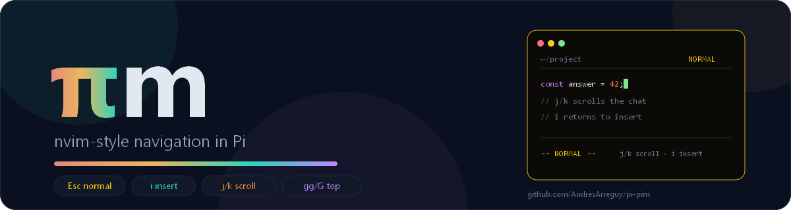

# Pim

[Español](README.es.md) · [English](README.md)

<p align="center">
  
</p>

<p align="center">
  <a href="https://github.com/AndresArreguy/pi-pim/stargazers">
    
  </a>
</p>

> ⭐ Si Pim te hace sentir Pi como en casa, [dejale una estrella al repo](https://github.com/AndresArreguy/pi-pim). Ayuda a que otros usuarios de Vim lo encuentren.

[](https://pi.dev/packages)

**Pim = Pi + Vim.** Un editor modal para Pi: escribís en insert mode, apretás
`Esc` para entrar en normal mode y usás `j`/`k` para scrollear el transcript del
chat — no el historial de prompts.

## Features

- **Insert mode** — el comportamiento normal del editor de Pi.
- **Normal mode** — `Esc` desde insert.
- **Scroll del chat** — `j`/`k` una línea; `Ctrl+D`/`Ctrl+U` media página;
  `Ctrl+F`/`Ctrl+B` página completa; `gg`/`G` principio/final.
- **Edición del prompt estilo Vim** — `h`/`l`, `0`/`$`, `x`, `i`, `a`.
- **Indicador de modo** — ` NORMAL ` / ` INSERT ` en el borde del editor.
- **Sin secuestrar el historial** — las flechas `↑`/`↓` en insert siguen
  funcionando como en Pi.

## Keymap

### Insert

Edición estándar de Pi: escribir, mover, pegar, autocompletar, `Enter` para
enviar, atajos `Ctrl+...`. `Esc` pasa a normal.

### Normal

| Tecla | Acción |
|---|---|
| `i` | insertar en el cursor |
| `a` | insertar después del cursor |
| `h` / `l` | cursor izquierda / derecha |
| `0` / `$` | inicio / final de línea |
| `x` | borrar carácter |
| `j` / `k` | scroll del chat abajo / arriba una línea |
| `Ctrl+D` / `Ctrl+U` | media página abajo / arriba |
| `Ctrl+F` / `Ctrl+B` | página abajo / arriba |
| `gg` | ir al principio del chat |
| `G` | ir al final del chat |
| `Enter` | enviar el prompt |
| `Esc` | pasa a Pi (interrupt / abort) |

## Instalación

Desde GitHub:

```bash
pi install git:github.com/AndresArreguy/pi-pim
```

Fijado a un tag:

```bash
pi install git:github.com/AndresArreguy/pi-pim@v1.0.0
```

Desde un clon local:

```bash
git clone https://github.com/AndresArreguy/pi-pim.git
cd pi-pim
pi install .
```

Reiniciá Pi o corré:

```text
/reload
```

> Pim reemplaza el editor principal con `ctx.ui.setEditorComponent()`. Si tenés
> otra extensión de editor custom, quitála: la última registración gana.

## Requisitos

- Pi **1.5.x**.
- Node.js **22.6+**.
- **Fullscreen mode** (`tuiMode: "fullscreen"`, el default de Pi) para el scroll
  del transcript. En regular mode la edición modal sigue andando, pero `j/k`,
  `Ctrl+D/U`, `Ctrl+F/B` y `gg/G` no tienen viewport que scrollear.

## Cómo funciona

Pim extiende el `CustomEditor` de Pi:

1. En `session_start` llama a `ctx.ui.setEditorComponent()` con el editor modal.
2. `handleInput` intercepta `Esc` y las teclas de normal mode.
3. `j/k`, las teclas de página y `gg/G` llaman a `scrollBy`, `scrollToTop` y
   `scrollToBottom` del TUI fullscreen, así mueven el transcript donde llegan
   las respuestas del agente.
4. El borde inferior se extiende con el modo actual.

No modifica el historial de prompts ni el transcript de Pi.

## Limitaciones

- El scroll del transcript es solo fullscreen.
- Es una capa modal enfocada, no un Vim completo: no hay operadores (`dw`, `ciw`),
  visual mode, registros ni comandos `:` (por ahora).
- `Esc` en normal mode mantiene el comportamiento de interrupt/abort de Pi.

## Desarrollo

```bash
git clone https://github.com/AndresArreguy/pi-pim.git
cd pi-pim
npm run check      # chequeo de sintaxis, sin build
pi install .       # carga el paquete local
```

Editá `index.ts`, corré `/reload` en Pi y probá en una sesión fullscreen.

## ⭐ Apoyo

Si Pim te hace sentir Pi como en casa, dejale una estrella al repo:

[](https://github.com/AndresArreguy/pi-pim/stargazers)

Issues y pull requests son bienvenidos.

## Créditos

Construido sobre [Pi](https://github.com/earendil-works/pi) por el equipo de Pi.

## Licencia

MIT © 2026 Andres Arreguy.
