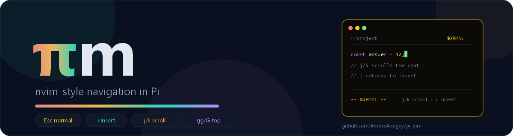

# Pim

[English](README.md) · [Español](README.es.md)

<p align="center">
  
</p>

<p align="center">
  <a href="https://github.com/AndresArreguy/pi-pim/stargazers">
    
  </a>
</p>

> ⭐ If Pim makes Pi feel like home, [star the repo](https://github.com/AndresArreguy/pi-pim). It helps other Vim users find it.

**Pim = Pi + Vim.** A modal editor for Pi: type in insert mode, press `Esc` to
enter normal mode, and use `j`/`k` to scroll the chat transcript — not the
prompt history.

## Features

- **Insert mode** — Pi's normal editor behavior.
- **Normal mode** — `Esc` from insert.
- **Chat scrolling** — `j`/`k` scroll the transcript one line; `Ctrl+D`/`Ctrl+U`
  half page; `Ctrl+F`/`Ctrl+B` page; `gg`/`G` top/bottom.
- **Vim-style prompt editing** — `h`/`l`, `0`/`$`, `x`, `i`, `a`.
- **Mode indicator** — ` NORMAL ` / ` INSERT ` on the editor border.
- **No prompt-history hijack** — insert-mode `↑`/`↓` keep working as Pi normally
  does.

## Keymap

### Insert

Standard Pi editing: type, move, paste, autocomplete, `Enter` to submit,
`Ctrl+...` shortcuts. `Esc` switches to normal.

### Normal

| Key | Action |
|---|---|
| `i` | insert at cursor |
| `a` | insert after cursor |
| `h` / `l` | cursor left / right |
| `0` / `$` | line start / end |
| `x` | delete character |
| `j` / `k` | scroll chat down / up one line |
| `Ctrl+D` / `Ctrl+U` | half page down / up |
| `Ctrl+F` / `Ctrl+B` | page down / up |
| `gg` | scroll chat to top |
| `G` | scroll chat to bottom |
| `Enter` | submit the prompt |
| `Esc` | pass through to Pi (interrupt / abort) |

## Install

From GitHub:

```bash
pi install git:github.com/AndresArreguy/pi-pim
```

Pinned:

```bash
pi install git:github.com/AndresArreguy/pi-pim@v1.0.0
```

From a local clone:

```bash
git clone https://github.com/AndresArreguy/pi-pim.git
cd pi-pim
pi install .
```

Restart Pi or run:

```text
/reload
```

> Pim replaces the main editor via `ctx.ui.setEditorComponent()`. Remove other
> custom-editor extensions if you have one installed; the last registration wins.

## Requirements

- Pi **1.5.x**.
- Node.js **22.6+**.
- **Fullscreen mode** (`tuiMode: "fullscreen"`, Pi's default) for transcript
  scrolling. In regular mode the modal editing still works, but `j/k`,
  `Ctrl+D/U`, `Ctrl+F/B` and `gg/G` have no transcript viewport to scroll.

## How it works

Pim extends Pi's `CustomEditor`:

1. On `session_start` it calls `ctx.ui.setEditorComponent()` with a modal editor.
2. `handleInput` intercepts `Esc` and normal-mode keys.
3. `j/k`, page keys and `gg/G` call the fullscreen TUI's `scrollBy`,
   `scrollToTop` and `scrollToBottom`, so they move the transcript where agent
   responses arrive.
4. The bottom border is extended with the current mode.

It does not modify the prompt history or Pi's transcript.

## Limitations

- Fullscreen-only transcript scrolling.
- This is a focused modal layer, not a full Vim: no operators (`dw`, `ciw`), visual
  mode, registers, or `:` commands (yet).
- `Esc` in normal mode keeps Pi's interrupt/abort behavior.

## Development

```bash
git clone https://github.com/AndresArreguy/pi-pim.git
cd pi-pim
npm run check      # syntax check, no build step
pi install .       # load the local package
```

Edit `index.ts`, run `/reload` in Pi, and test in a fullscreen session.

## ⭐ Support

If Pim makes Pi feel like home, please star the repo:

[](https://github.com/AndresArreguy/pi-pim/stargazers)

Issues and pull requests are welcome.

## License

MIT © 2026 Andres Arreguy.
